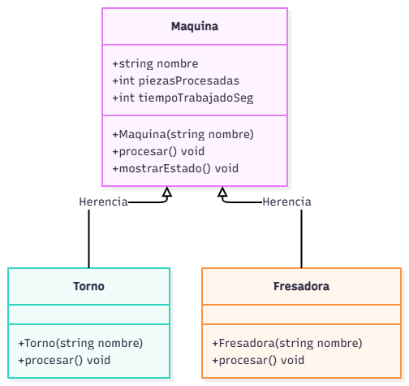
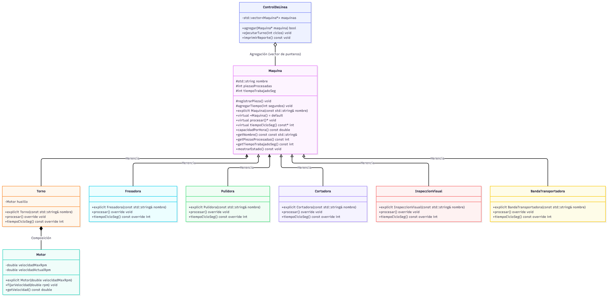

# Práctica Unidad IV: La evolución de una máquina

Programación Orientada a Objetos · Ingeniería Mecatrónica · Tercer semestre

Llena cada espacio conforme avances en las fases de [PRACTICA.md](PRACTICA.md).

## Fase 1. Entender el problema

**1.1 El problema con mis propias palabras**

La planta de manufactura que se trabajo durante el segundo parcial tiene las maquinas torno, fresadora, pulidora, estación de inspección y banda transportador que trabajan en conjunto en una linea de produccion. Cada maquina tiene un nombre, cuenta las piezas procesadas, el tiempo trabajado y sabe cuanto  tiempo dura un ciclo. Finalmente la planta ejecuta turnos y genera un reporte con las piezas, el tiempo y la capacidad por hora de cada máquina.

**1.2 Reglas que siempre deben cumplirse en una máquina** (escribe al menos tres)

1. Responsabilidad Unica
2. Proteccion de Datos Heredados 
3. Sobrescribir Metodos (virtual - override) / Polimorfismo

**1.3 ¿Quién más usa la clase `Maquina`? ¿Qué podría salir mal si otro equipo crea una máquina nueva sin conocer tus reglas?**

En caso de que otro equipo contribuya y desconozca de estas reglas puede ocurrir lo siguiente:
- Pérdida de encapsulamiento: Si los datos heredados no se protegen adecuadamente, cualquier programador podría modificarlos externamente de forma incorrecta, con el peligro de corromper el estado de la máquina y alterar los reportes de la planta.
- Ruptura del polimorfismo: Al no respetar el contrato de la clase base , se pierde la ventaja de tratar a todas las máquinas de forma genérica. El programa principal ya no podría interactuar con la máquina específica mediante polimorfismo.
- Ignorando el principio de responsabilidad unica, otros programadores podrian agregar responsabilidades extra a una maquina.

## Fase 2. Diseñar la solución

**2.1 Diagrama inicial (Etapa 0)**

**2.2 Diagrama final (Etapa 9)**

**2.3 ¿Qué cambió entre los dos diagramas?**

| Elemento | Etapa 0 | Etapa 9 | Etapa que lo cambió |
| --- | --- | --- | --- |
| Visibilidad de los atributos de `Maquina` | _____ | _____ | _____ |
| `procesar()` | _____ | _____ | _____ |
| `tiempoCicloSeg()` | _____ | _____ | _____ |
| Destructor de `Maquina` | _____ | _____ | _____ |
| ¿Se pueden crear objetos `Maquina`? | _____ | _____ | _____ |
| Relación `ControlDeLinea` - `Maquina` | _____ | _____ | _____ |
| Relación `Torno` - `Motor` | _____ | _____ | _____ |
| Relación `BandaTransportadora` - `Motor` | _____ | _____ | _____ |

## Fase 3. Implementar

**3.0 Etapa 0. Una máquina sin reglas**

a) ¿Qué imprime `ejecutarTurno()` para el torno y la fresadora? ¿Por qué no imprime "torneando" ni "fresando"?

Torno T-01: procesamiento generico
Fresadora F-01: procesamiento generico
Use code with caution.

No imprime los mensajes específicos porque en la clase base Maquina falta la palabra clave virtual en el método procesar(). Como la función ejecutarTurno recibe una Maquina& genérica, el compilador se confunde y decide ejecutar el código del padre (enlace estático), ignorando por completo que en realidad le pasaste un torno y una fresadora.

b) ¿Por qué el torno acumula 65 s y no 135 s?

El tiempo se calcula mal debido a que el programa suma dos cosas distintas en el main:
	1. La llamada directa: Suma 45 segundos porque se llama desde la variable torno directamente y ahí sí encuentra su código.
	2. El turno de 2 ciclos: Al entrar a ejecutarTurno, el compilador corre el código genérico de la clase padre en lugar del código del torno. Como cada ciclo genérico dura 10 segundos, solo se suman 20 segundos (\(10 \times 2\)).
Al final, el total se queda en (45 + 20 = 65) segundos, en lugar de los 135 segundos que deberían ser si los tres ciclos hubieran trabajado como un torno real.

**3.1 Etapa 1. Invariantes y constructores explicit**

a) ¿Qué regla de la sección 1.2 rompió `torno.piezasProcesadas = -5;`?

Rompio la regla de proteccion de datos, ninguna maquina puede procesar piezas negativas. Poniendo las variables en un espacio publico, en cualquier parte del programa se pueden modificar estos valores, destruyendo la logica y funcionalidad del reporte de la linea de produccion.

b) ¿De dónde salió la máquina "Fantasma"? ¿Qué hizo el compilador sin que se lo pidieras?

El compilador hizo una conversion  automatica, como la funcion de imprimirFicha pide una maquina y en el main se agrego un pedazo de string "Fantasma" (variable codigo), C++ utilizo el texto y lo convirtio gracias al constructor.

c) ¿Qué tuviste que cambiar en `Torno` y `Fresadora` y por qué?

Debido a los cambios hechos en maquina.h de poner los atributos en privado y la palabra explicit para evitar conversiones automaticas, las clases hijas (fresadora, torno) ya no pudieron modificar los valores directamente dentro de sus archivos. Por lo tanto, se crearon  funciones publicas y protegidas (agregarTiempo y registrarPieza) para controlar y validar la entrada de valores, ademas de que se agrego la palabra explicit para evitar conversiones.

**3.2 Etapa 2. Virtual y override**

a) La fresadora acumula 180 s, pero reporta 360 pzas/h. ¿Por qué un cálculo usó 60 s y el otro 10 s?

El programa uso el tiempo acumulado de 60 seg de procesar() porque si pudo enlazar directamente con el objeto derivado (fresadora). Por otro lado, en el caso de capacidadPorHora(), la cual vive dentro de maquina.h, no logra conectar con la clase hija y termina usando su valor por defecto debido a que no tiene la misma firma (override/virtual).

b) ¿Tu compilador mostró alguna advertencia antes de usar `override`? ¿Qué mensaje dio después de agregar `override`?

El compilador no mostro ningun error  y compilo, sin embargo como la firma de algunos metodos no coincidian, el programa penso que se trataba de un nuevo metodo y se estaba sobresrcibiendo, liberando una salida erronea. Despues, al agregar el override mostro la salida esperada.

**3.3 Etapa 3. La línea de producción**

a) ¿Por qué la línea procesó todo como "generico" si `procesar()` ya es virtual?

La linea proceso "generico" todo ya que se encontro con el object slicing, el controlDeLinea pasa por exclusivamente Maquinas y al querer pasar por la fresadora o torno, no las reconoce y tira todas las caracteristicas especiales de las clases hijas.

b) ¿Por qué el torno y la fresadora originales quedaron con 0 piezas?

Al igual que el punto 3.3, las clases derivadas originales se quedaron en 0 pzas, porque en vez de que la linea apuntara una de estas maquinas, el programa creaba una maquina generica y hacia el slicing.

c) La relación entre `ControlDeLinea` y `Maquina`, ¿es composición o agregación? ¿Por qué?

La relacion entre maquina y ControlDeLinea es agregacion ya que las maquinas pueden vivir sin la linea, si la linea deja de existir la fresadora o el torno siguen existiendo porque no mueren junto con la linea.

**3.4 Etapa 4. Destructores**

| Momento | Mensajes de destrucción que aparecieron |
| --- | --- |
| `delete temporal;` sin destructor virtual |  Destruyendo Torno
 Destruyendo Motor
Destruyendo Maquina |
| `delete temporal;` con destructor virtual | Destruyendo Torno
 Destruyendo Motor
Destruyendo Maquina |
| Al terminar `main` (torno y fresadora) | Destruyendo Maquina
Destruyendo Torno
 Destruyendo Motor
Destruyendo Maquina |

a) ¿Qué advertencia mostró el compilador? ¿Por qué decimos que ya te estaba avisando del problema?

src/main.cpp:21:5: warning: deleting object of polymorphic class type 'Maquina' which has non-virtual destructor might cause undefined behavior [-Wdelete-non-virtual-dtor] El compilador arroja este mensaje antes porque sabe que estas usando polimosfismo y al no tener el destructor virtual en maquina.h el compilador puede olvidar destruir las clases hijas y solo eliminar la maquina base. 

b) ¿Por qué el torno de `main` sí se destruyó completo aunque el destructor no fuera virtual? ¿A qué máquina corresponde el primer "Destruyendo Maquina" después de "Fin de main"?

En el main el torno si fue destruido ya que la maquina se creo localmente, por lo tanto sabia el tipo real y exacto. La primer maquina destruida corresponde a la ultima maquina declarada dentro del main de acuerdo a los conceptos LIFO (last in, first out).
**3.5 Etapa 5. La clase abstracta**

a) Copia los mensajes de error y explica con tus palabras qué dice cada uno.

src/main.cpp:10:14: error: cannot declare variable 'pulidora' to be of abstract type 'Pulidora'
   10 |     Pulidora pulidora("Pulidora P-01");
   Este error aparece debido a que hicimos la clase maquina.h abstracta y creamos metodos puros, creando una regla a las clases hijas a desarrollar y sobrescribir estos metodos, en este momento no se habia implementado el metodo de procesar en pulidora.

src/main.cpp:11:13: error: cannot declare variable 'generica' to be of abstract type 'Maquina'
   11 |     Maquina generica("Maquina sin tipo"); 
Este error surge porque en POO las clases abstractas no pueden instanciar directamente, estas plantillas definen el que va a hacer, mas no como lo hacen.
b) ¿Por qué es mejor este error de compilación que el comportamiento "generico" de antes?

Es mejor este error de compilacion ya que de avisa del error logico que tienes, en vez de que mienta el programa y emita una salida erronea. Ademas te detiene al ingresar maquinas fantasmas o si te falto desarrollar alguno de los metodos puros que establecio la maquina base, te lo dice.

**3.6 Etapa 6. El contrato que el compilador no ve**

a) ¿Qué partes del contrato violó `InspeccionVisual`?
Por parte de procesar y agregarTiempo, InspeccionVisual nunca llamo a que registaran la pieza y nunca agrego el tiempo trabajado, por lo que en el reporte de inspeccion se quedo en 0 pzas procesadas y 0 seg.

b) ¿Por qué el compilador no lo detectó?

El compilador no lo detecta porque solo revisa que las firmas y parametros sean correctos. No entiende la logica y la complejidad del contrato que se establecio de manera externa.

c) ¿Qué pasaría si el próximo equipo tampoco lee el comentario del contrato?

Ocurriria otra falla igual. Los contribuidores podrian ignorar o olvidar que hay una regla de por medio que toda maquina debe seguir, e introducirian su propia logica.

**3.7 Etapa 7. La base hace cumplir el contrato**

a) ¿Cómo puede una clase derivada sobrescribir un método que es privado en la base?

La etiqueta private bloque quien puede ver o llamar al metodo desde afuera, sin embargo no afecta al polimorfismo, al usar virtual la clase base puede usar una propia verion de las clases hijas.

b) ¿Qué ocurre ahora con una máquina cuyo tiempo de ciclo es 0? Compáralo con la Etapa 6.

En la etapa 6 el programa no decia nada y pasaba desapercibido valores invalidos (pzas negativas o infinitas). En la etapa 7 se agregaron validaciones y restricciones para que en el momento de que haya un valor invalido el try-catch lo puede reconocer.

c) ¿Por qué la línea ignoró el "atajo" del torno, pero la llamada directa no? ¿Cómo corregiste el diseño?

La linea maneja las maquinas a travez de la clase base, usando el metodo oficial, debido a esto los metodos sueltos que esten por fuera a una clase derivada no se ejecutan.

**3.8 Etapa 8. Herencia mal usada**

a) Da al menos dos razones por las que `BandaTransportadora : public Motor` es un error de diseño.

[Inserta aquí tu respuesta]

b) La relación entre `BandaTransportadora` y `Motor`, ¿es composición o agregación? ¿Por qué?

[Inserta aquí tu respuesta]

**3.9 Etapa 9. La librería y la prueba final**

a) Después de agregar la `Cortadora`, ¿qué archivos mostró `git status`? ¿Cuántos archivos de la librería tuviste que modificar?

[Inserta aquí tu respuesta]

b) ¿Qué pasó al escribir `-lplanta` antes de `src/main.cpp`? ¿Por qué?

[Inserta aquí tu respuesta]

**3.10 Bitácora de dudas**

| # | Etapa | Duda | Cómo la resolví | Fuente |
| --- | --- | --- | --- | --- |
| 1 | _____ | _____ | _____ | _____ |
| 2 | _____ | _____ | _____ | _____ |
| 3 | _____ | _____ | _____ | _____ |

## Fase 4. Probar y mejorar

**4.1 Tabla de pruebas**

| # | Caso | Resultado esperado | Resultado obtenido | ¿Pasa? |
| --- | --- | --- | --- | --- |
| 1 | Máquina con nombre vacío | Excepción con mensaje claro | _____ | _____ |
| 2 | Reporte de una línea vacía | "La linea no tiene maquinas" | _____ | _____ |
| 3 | `agregar(nullptr)` | Devuelve `false` | _____ | _____ |
| 4 | Reporte antes de ejecutar el turno | 0 piezas, 0 s y capacidad calculada | _____ | _____ |
| 5 | Turno de 0 ciclos | Nada cambia | _____ | _____ |
| 6 | Torno con 3 ciclos | 3 piezas, 135 s, 80 pzas/h | _____ | _____ |
| 7 | Máquina con `tiempoCicloSeg()` igual a 0 | Excepción con mensaje claro | _____ | _____ |
| 8 | Máquina con `tiempoCicloSeg()` negativo | Excepción con mensaje claro | _____ | _____ |
| 9 | La misma máquina agregada dos veces | _____ | _____ | _____ |

**4.2 Bitácora de mejoras**

| # | Falla o mejora detectada | Qué cambié | Por qué |
| --- | --- | --- | --- |
| 1 | _____ | _____ | _____ |
| 2 | _____ | _____ | _____ |

Retos opcionales que intenté: _____

## Fase 5. Publicar en GitHub

**5.1 Enlace a mi fork**

[Inserta aquí el enlace a tu fork]

## Cierre y reflexión

**6.1 Errores que ya no pueden ocurrir**

| Error | Etapa en que apareció | Restricción que lo impide ahora | ¿Quién lo detecta: el compilador o el programa? |
| --- | --- | --- | --- |
| Contadores con valores inválidos | _____ | _____ | _____ |
| Máquina "fantasma" creada a escondidas | _____ | _____ | _____ |
| Método que no sobrescribe por un `const` | _____ | _____ | _____ |
| Máquinas copiadas y "rebanadas" | _____ | _____ | _____ |
| Destrucción incompleta | _____ | _____ | _____ |
| Máquina sin `procesar()` propio | _____ | _____ | _____ |
| Tiempo de ciclo inválido | _____ | _____ | _____ |
| Derivada que no registra sus piezas | _____ | _____ | _____ |

**6.2 ¿Cuál de los errores fue el más peligroso: el de compilación, la advertencia o el que compilaba sin problemas? ¿Por qué?**

[Inserta aquí tu respuesta]

**6.3 ¿Qué aprendiste en esta práctica?**

[Inserta aquí tu respuesta]

**6.4 ¿Qué cambiarías de tu proceso la próxima vez?**

[Inserta aquí tu respuesta]
